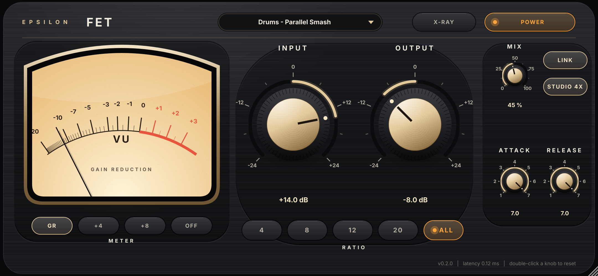

# Epsilon FET v0.2.0 — circuit-modelled FET compressor

> Development status: v0.2.0 candidate. The owner has not yet installed or auditioned this version. Prior testing by Claude is reported by the owner; supplied measurements have not been independently reproduced during this repository import. Mac CI and FL Studio validation are pending until runs are recorded.

A 1176 Rev D–family compressor that simulates the circuit itself. The FET, the C22 detector capacitor, the rectifier diodes, the input and output transformers and the class-A output transistor are each solved as electrical parts (volts, amps, ohms), with implicit integration and bounded Newton steps, at 4× the host rate. Built from the Epsilon Analog Research dossier (05 Nov 2026). Full guide with a picture of every control: `Epsilon FET Manual.pdf`.

## Open and build (Mac)
Everything is inside this folder, including JUCE 9.0.5 (`JUCE/`).

1. Double-click **`EpsilonFET.jucer`**. It opens in Projucer with all the code in.
2. Click the Xcode button at the top (Save and Open in IDE).
3. In Xcode choose the scheme **Epsilon FET - All**, then Product > Build.
4. Xcode copies the plugin to `~/Library/Audio/Plug-Ins/VST3/` and `Components/` (AU). Rescan in your DAW.

Debug and Release are both `-O3` in every exporter (Xcode's Build/Run uses Debug); an unoptimised build shows **SLOW UNOPTIMISED BUILD** in red. Windows: `Builds/VisualStudio2022`. CMake: `cmake -B build -DCMAKE_BUILD_TYPE=Release && cmake --build build` (downloads JUCE). `.github/workflows/build.yml` builds, tests and validates it on GitHub's Mac runner once the project is in a GitHub repo.

## Controls
| Control | Range | Default | What it does |
|---|---|---|---|
| Input | −24 … +24 dB | 0 dB | Drive into the FET. Threshold is fixed: more Input = more compression |
| Output | −24 … +24 dB | 0 dB | Level into the class-A output stage and transformer |
| Attack | 1 … 7 | 3 | 7 fastest (detector RC 20 µs) … 1 slowest (~0.8 ms) |
| Release | 1 … 7 | 7 | 7 fastest (~50 ms) … 1 slowest (~1.1 s) |
| Ratio | 4 / 8 / 12 / 20 / All | 4 | Sidechain ratio network; higher ratios have higher thresholds; All = all buttons in |
| Mix | 0 … 100 % | 100 % | Parallel blend; the dry path shares the oversampling filters, so no comb filtering |
| Link | on / off | on | Channels share one detector capacitor |
| Quality | Studio 4x / Eco 2x | Studio | Rate the circuit is simulated at |
| Meter | GR / +4 / +8 / Off | GR | VU meter mode (GUI only) |
| Power | on / off | on | Bypass with the latency kept |

## The window (v0.2.0): "X-ray hardware"
Designed as a product, not a test panel: one hero element (a large cream VU in a champagne bezel), an original colourway (graphite body, champagne-gold machined knobs), amber used only for live things (meter lamp, active ratio, power, X-ray), a few deliberate curves, and labels sized to read at the smallest window.
**X-RAY** turns the faceplate into smoked glass and shows the circuit being simulated, live, each part behind the control that drives it (Input pot under the Input knob, the FET between the big knobs, detector and C22 under Attack, release resistor under Release). It is a view only: the sound is identical. X-ray redraws the whole window at 20 fps (software-rendered, then blitted); with it off the circuit view costs nothing.

## The model (`Source/FetCircuit.h`)
- **JFET (Q1, 2N5457 class):** `Id = β[f(Vgs−Vp) − f(Vgd−Vp)](1+λ|Vds|)`, `f(x) = softplus(x)²`, which equals the dossier's triode relation `β[2(Vgs−Vp)Vds − Vds²]` and is symmetric in drain and source. 48.5 % of the drain voltage is fed back to the gate (ideal 50 %) — the 1176's linearisation — so the residual mismatch and λ make the harmonics.
- **FET node:** `(va − v)/R5 = Id(v) + v/Rpre`, R5 = 27 kΩ, solved per sample with damped Newton (≤ 4 steps).
- **Bias:** solved at prepare like the UA Q-bias procedure: gate set so the FET takes exactly 1 dB at rest; the preamp makes it up.
- **Detector:** ratio network → full-wave diode (Shockley, FDH333-like) in series with the attack resistance into C22 = 0.22 µF, drained by the release resistance; trapezoidal integration with Newton on the diode current.
- **Transformers:** flux-integrating magnetising inductance with saturation (inductance falls with flux), source/winding resistance and reflected load; bass saturates first. Nominal values (unmeasured magnetics).
- **Output stage (Q6):** exponential-junction class-A curve with supply rails.
- **Level convention:** −18 dBFS peak sine = +4 dBu (dossier section 09).

**Fitted values** (no hardware unit was measured): FET drive level, the sidechain drive / threshold / gate scaling of each ratio network (`tests/fit_ratios.py`, against the real output level), and the attack/release endpoints (both inside the schematic's 25 kΩ and 5 MΩ pots). Everything else is the nominal part value.

## Measured (`tests/measure_engine.py` → `docs/measurements.md`)
| Test | Result | Published 1176 |
|---|---|---|
| Attack 7 → 1 (63 %, 1 kHz step) | 102 µs → 760 µs (detector RC 20 µs → 0.8 ms) | 20 µs – 800 µs |
| Release 7 → 1 (63 %) | 52 ms → 1.09 s | 50 ms – 1.1 s |
| Ratio slopes above the knee | 4.4 / 12.2 / 15.3 / 23.9 : 1 | 4 / 8 / 12 / 20 : 1 nominal |
| THD, compressor off, +4 dBu | 0.10 % | < 0.5 % |
| THD, 4:1 with ~4 dB GR | 0.25 % | < 0.5 % |
| 50 Hz, attack/release 7 | 4.7 % (3rd harmonic: the bass grit) | — |
| Rate invariance, 88.2–384 kHz internal | GR within 0.01 dB | — |

Plugin-level (`tests/PluginTest.cpp`, CMake target `EpsilonPluginTest`): unity at rest (−0.004 dB); reported latency = measured (6 samples at 48 kHz); 50 % mix within 0.44 dB of flat; identical output for 32/256/1024-sample blocks; aliases of a 15 kHz tone under heavy compression below −100 dBFS; fast automation of every control with no clicks; presets and state restore. CPU on the Linux build machine (not an Intel Mac): Studio 4x median 13 % / p99.9 27 % of a 64-sample block at 44.1 kHz, Eco 2x 7 % / 13 %. The Mac CI prints the same test on GitHub's runner.

## Tests
- `tests/measure_engine.py` — engine measurements (builds `tests/engine_capi.cpp` with g++).
- `tests/fit_ratios.py` — refits the ratio networks.
- `EF_BUILD_TESTS=ON` → `EpsilonPluginTest`, `EpsilonShots` (renders the window and every control for the manual).
- `docs/manual/build_manual.py` — builds the manual from those pictures.

## Next steps toward a hardware match
Capture a named 1176/derivative unit with the research's protocol (linear transfer, compression staircases, bursts, harmonics, stereo cases) and fit the FET spread, ratio networks and transformer magnetics to it. The engine keeps nominal and fitted values separate in `CircuitSpec` for exactly that.
